# Analýza plánovania trás a obrazovky – Odkiaľ Kam v1.7.3

Stav k 11. 11. 2026. Analyzovaná je verzia 1.7.3 (cestovné poriadky platné do 22. 12. 2026).
Klikateľná ukážka návrhu: [`jednoduchy-rezim-ukazka.html`](jednoduchy-rezim-ukazka.html) (otvor v prehliadači, najlepšie v telefóne).

## 1. Zhrnutie

**Plánovanie je spoľahlivé a medzi bežnými zastávkami takmer vždy optimálne. Slabšie je na okrajoch mesta, večer a pri ceste z adresy – tam appka vyberá zastávky príliš úzko a občas pošle čakať do rána, hoci neďaleko ide autobus. Obrazovka je funkčná a rýchla, ale pre seniorov a deti drobná a na niekoľkých miestach neodpúšťa chyby.**

Čo je najdôležitejšie:

1. **Žiadny vymyslený spoj.** V 26 187 skontrolovaných kartách nebola ani jedna jazda, ktorá by v cestovnom poriadku nebola, a ani jeden nestihnuteľný prestup.
2. **Medzi 25 najvyťaženejšími zastávkami je najskoršia karta do 1 minúty od najlepšieho možného príchodu v 97–98 % hľadaní** a do 5 minút v 98–99 %.
3. **Výber zastávok je príliš úzky.** Pri ceste z adresy berie appka len 8 najbližších nástupíšť (v praxi asi 4 zastávky) do 700 m. V 1,6–2,6 % hľadaní preto napíše „Žiadne spojenie“ a v ďalších asi 5 % ponúkne spoj až na druhý deň, hoci zo zastávky 1–1,3 km ďaleko ide autobus skôr.
4. **Prestupy nemajú rezervu.** Na tej istej zastávke appka odporučí aj prestup s 0 minútami. Takýto prestup (0–1 min) má 7,5 % odporúčaných spojení; DPMP pritom uvádza toleranciu odchodov ±2 min.
5. **Karta nepovie, kedy vyraziť z domu, a neoznačí spoj na zajtra.** Chôdza na prvú zastávku (medián 4 min) na karte chýba a ranný spoj vyzerá ako dnešný.
6. **Našlo sa 6 chýb v plánovači a 5 na obrazovke** (kapitoly 3.6 a 4.3). Najvážnejšia z nich sa medzi vyťaženými zastávkami neprejavila ani raz.
7. **Pre deti a seniorov navrhujem „jednoduchý režim“:** veľké dlaždice cieľov, jedna odpoveď vo vetách, sprevádzanie krok za krokom, tlačidlá „Kde som?“ a „Zavolať“. Ukážka je priložená.
8. **Režim človeka na zastávku aj dovedie** (doplnené, kapitola 5.5): veľká šípka so vzdialenosťou, mapka, obrázok tabule zastávky a jedna kontrolná otázka, či stojí na správnom mieste. Až 61 % nástupíšť má do 60 m ďalšie nástupište s rovnakým menom, preto samotná poloha nestačí.

## 2. Ako sa meralo

- **Skutočný kód appky.** Plánovanie bežalo nad `app.js` a `raptor.js` verzie 1.7.3, obrazovka v prehliadači Chromium nad vydaným súborom `mhd-presov-v1.7.3.html`.
- **Nezávislý výpočet.** Najlepšie možné spojenie počítal samostatný program, ktorý nepoužíva kód appky (iný algoritmus, vlastný kalendár). Porovnalo sa 4 400 + 2 400 hľadaní zastávka → zastávka a 4 200 + 1 200 hľadaní od adresy k adrese, v štyroch typoch dní (školský deň, prázdniny, sobota, nedeľa).
- **Dvojitá kontrola.** Každú z piatich oblastí najprv spracoval jeden analytik a potom ju nezávisle preveril druhý, s vlastnými skriptmi a inou náhodnou vzorkou. Žiadny nález nebol vyvrátený; čísla nižšie sú už po spresnení overovateľmi. Kde sa dve merania líšia, uvádzam rozpätie.
- **Obmedzenia** sú v kapitole 7. Najdôležitejšie: meralo sa v prehliadači, nie na skutočnom telefóne, a s deťmi ani seniormi sa netestovalo.

## 3. Plánovanie trás

### 3.1 Čo funguje spoľahlivo

| Oblasť | Výsledok |
|---|---|
| Pravdivosť spojení | 26 187 kariet: 0 neexistujúcich jázd, 0 nestihnuteľných prestupov |
| Appka „lepšia“ než nezávislý výpočet | 0 zo 6 706 hľadaní (appka si teda nič neprikrášľuje) |
| Kalendár (pracovné dni, prázdniny, víkend, spoje po polnoci) | 0 nezhôd v 976 porovnaniach; nočné linky N1/N2 sa nájdu správne |
| Optimum podľa vlastných pravidiel appky | 98,4–98,7 % hľadaní (po oprave jednej chyby 99,5–99,6 %) |
| „Bez prestupu“ | 0 chýb na 1 100 hľadaniach |
| „Zostaň sedieť“ (62 väzieb) | fungujú všetky |
| Rada „Pešo to máš rovno do cieľa“ | logicky bez rozporu v 2 700 krátkych hľadaniach |
| Rýchlosť | 20–25 ms na hľadanie na serveri; odhad pre slabší telefón pod 0,3 s (odhad, nie meranie na telefóne) |

### 3.2 Sú spojenia s prestupmi optimálne?

Porovnanie najskoršej karty appky s najlepším možným príchodom:

| | 25 najvyťaženejších zastávok | Náhodné dvojice zastávok (veľa okrajových) |
|---|---|---|
| presne najlepší príchod | 85–90 % | 68–69 % |
| do 1 minúty | 97–98 % | 88–89 % |
| do 5 minút | 98–99 % | 92 % |

Prečo „presne“ nie je 100 %:

- **Zámer (asi 18 % hľadaní, medián 0,4 min, najviac 10 min):** appka uprednostní autobus až na zvolenú zastávku pred výstupom o zastávku skôr a chôdzou. Pre deti a seniorov je to správna voľba.
- **Úzke pravidlá pre cieľ (6,2–6,4 % hľadaní, z toho asi polovica o viac ako 10 min):** okolitú zastávku pri cieli appka uzná len do 700 m, najviac 12 zastávok, a len keď na ňu autobus príde priamo. Po poslednom spoji na riedko obsluhovanú zastávku potom už podvečer ponúkne ranný spoj. Príklad: Kúpeľná → Zlatobanská, štvrtok 19:16 – appka ukáže „5:32 → 6:13“, hoci sa dá prísť o 19:54 (výstup Solivar, 15 min pešo).
- **Chyba v plánovači (asi 1 % hľadaní medzi okrajovými zastávkami):** pozri 3.6, bod 1.

Ak sa za „najlepší príchod“ berie len to, čo appka sama považuje za prijateľné (zastávka do 700 m priamo z autobusu), je najskoršia karta presne najlepšia v 78 %, do 1 minúty v 97 % a do 10 minút v 99 % všetkých hľadaní.

### 3.3 Najbližšie nástupné a výstupné zastávky

Ako to appka robí: pri ceste z adresy vezme najviac 8 najbližších nástupíšť do 700 m vzdušnou čiarou (ak tam nie je žiadne, do 1 500 m). Pri cieli „zastávka“ pridá najviac 12 okolitých zastávok do 700 m. Chôdzu ráta ako vzdušnú čiaru × 1,2 pri 4,5 km/h.

| Zistenie | Čísla |
|---|---|
| Pokrytie adries | medián 168 m k najbližšej zastávke; 97,1 % adries má zastávku do 700 m |
| Strop 8 nástupíšť | obmedzuje 63,6 % adries; zmestia sa doň zvyčajne len 4 rôzne zastávky a skutočný dosah je medián 451 m |
| Bez stropov, stále do 700 m | príchod aspoň o 3 min skôr v 8–9 % hľadaní (za medián +6,5 min chôdze) |
| Zastávky až do 1 500 m | príchod aspoň o 3 min skôr v 29–30 % hľadaní, ale za medián +12 min chôdze; „lacný“ zisk (najviac +5 min chôdze) má len 5,7 % hľadaní |
| „Žiadne spojenie sa nenašlo“ | 1,6–2,6 % hľadaní, takmer všetky cez víkend; vo väčšine z nich zo zastávky do 1 500 m spoj ide |
| Spoj až na druhý deň | asi 5 % hľadaní od adresy |
| Štart zo zastávky | okolité zastávky sa neberú (len peší prestup do 400 m); s nimi by bol príchod aspoň o 10 min skôr v 13,5 % hľadaní zastávka → adresa |
| Ten istý autobus, bližšia zastávka | v rámci vybraných zastávok appka vyberie tú najbližšiu vždy (0 prípadov); v 2–4 % kariet ten istý autobus stojí bližšie na zastávke, ktorú vyradil strop alebo okruh 700 m |
| Chôdza na prvú zastávku | na karte chýba: medián 4,2–4,4 min, v 39–43 % kariet z adresy aspoň 5 min |
| Pomalší chodec | pri 3,6 km/h zmešká prvý spoj v 5–7 % odporúčaných spojení z adresy, pri 2,9 km/h v 11–12 % |

Príklady overené v appke:

- **Korpašská 1601/9 → Domašská 2639/39, štvrtok 17:19.** Appka ukáže „7:16 → 8:00“ (na druhý deň, bez označenia). Zo zastávky Medulienka (1 078 m, 17 min pešo) ide linka 45 o 18:03 s príchodom 18:53.
- **Rumanova 5724/12 → Slnečná 5530/8, štvrtok 21:47.** Osem miest zaberú Sládkovičova, 3× Detská nemocnica, Moyzesova a 3× Fakultná nemocnica. Zastávka Na Hlavnej (570 m) sa nezmestí; ide z nej linka 22 o 22:21 s príchodom 22:34. Appka ukáže „4:40 → 5:28“.
- **Tulčícka → Vlčie Doly 337, štvrtok 15:28.** Appka ukáže spoj o 7:16 na druhý deň; z Nám. sv. Jakuba (541 m) ide linka 45 o 16:32 s príchodom 17:24.

Hodnotenie: appka vyberá **najbližšie** zastávky správne, ale nie vždy **najbližšie užitočné**. Pevný okruh nezohľadňuje, či zo zastávok v danom čase niečo ide. Je to obmedzenie návrhu, nie chyba v kóde.

Čo sa overiť nedalo: či je odhad chôdze (vzdušná čiara × 1,2) realistický. V repozitári nie je sieť chodníkov, mostov a železnice, takže skutočné pešie trasy sa nedali spočítať.

### 3.4 Zoznam spojení a odporúčaná karta

| Zistenie | Čísla |
|---|---|
| Najskorší možný príchod je medzi kartami | 99,7–99,9 % hľadaní |
| Odporúčaná (prvá) karta nie je najrýchlejšia | 6–9 % hľadaní; väčšinou výmenou za menej prestupov (296 z 390 prípadov) |
| O koľko neskôr vtedy príde | medián 4–6 min, v desatine prípadov 19–39 min, najviac asi 2 hodiny (večer, keď appka uprednostní ranný spoj) |
| V zozname chýba užitočný odchod | 11–14 % hľadaní; v 10–11 % by sa ním prišlo aspoň o 10 min skôr než najbližšou zobrazenou kartou |
| Karta so zbytočne skorým odchodom | odísť sa dá aspoň o 10 min neskôr v 5–10 % hľadaní (odporúčaná karta menej než 1 %) |
| Karty s odchodom na druhý deň bez označenia | 10,6–11,3 % kariet v náhodnej vzorke; medzi vyťaženými zastávkami 3,4 % |
| Večer 20:00–22:29: prestup s čakaním 2 a viac hodín | 9,4–9,6 % kariet, v štvrtine hľadaní |

Prečo chýbajú odchody: hľadanie sa zastaví po štyroch spojeniach a štvrté miesto často zaberie priamy spoj o hodiny neskôr. Tlačidlá „Neskôr“ a „Skôr“ v appke nie sú; iný čas treba zadať ručne a znova hľadať.

Odporúčanie prvej karty (príchod + 5 min za prestup + polovica chôdze navyše − štvrtina neskoršieho odchodu) je cez deň rozumné. Večer však zľava za neskorší odchod spôsobí, že prvá karta je ranný spoj, hoci existuje večerný.

### 3.5 Prestupy

- **Na tej istej zastávke nie je žiadna minimálna rezerva.** Stačí, aby ďalší autobus odchádzal v tej istej minúte.
- **Pri zmene nástupišťa** appka ráta peší presun, najmenej 2 minúty, v ktorých je už 1 minúta rezervy.
- **Odporúčané karty:** 4,9 % má prestup na tej istej zastávke s 0 minútami, 7,5 % s najviac 1 minútou. Ak sa zarátajú aj zmeny nástupišťa, je to 16–19 %.
- **Karta rezervu neukazuje.** Čakanie sa vypíše až od 2 minút.
- **Čo by stálo zaviesť minimum 2 minúty na tej istej zastávke:** neskorší príchod v 7 % hľadaní, medián o 5 min. Pri 1 minúte v 4 %.
- **Najviac 3 prestupy.** Komentár v kóde hovorí o štyroch; štvrtý by pomohol v 0,04–0,14 % hľadaní.
- **Možno chýbajúce väzby „zostaň sedieť“.** Analýza našla 136 spojov, ktoré vyzerajú, že pokračujú ako iná linka (najčastejšie 41 → 42 pri Veľkej pošte). **U DPMP to overené nie je** a jeden z príkladov sa pri kontrole ukázal ako nevhodný. Bez overenia sa do appky dopĺňať nesmú.

### 3.6 Nájdené chyby v plánovači

| # | Chyba | Dopad | Návrh opravy |
|---|---|---|---|
| 1 | Pri výpočte sa príchod autobusom na zastávku prepíše skorším príchodom pešo a platné spojenie sa stratí (`raptor.js:181–189, 125`) | v asi 1 % hľadaní medzi okrajovými zastávkami appka nenájde svoje najlepšie spojenie; príchod je potom neskorší o medián 13 min, najviac o 4,5–5 hodín; medzi vyťaženými zastávkami 0 prípadov z 1 992 | viesť príchod jazdou a pešo oddelene; skúšobná oprava je v `podklady/raptor-oprava-stitkov.diff`, prešla všetkými 19 kontrolami `test-router` a odstránila všetky prípady |
| 2 | Karta má dva pešie úseky za sebou a v hlavičke neskorší príchod, než dávajú úseky | 0,1–0,15 % kariet; rozdiel až 84 min; pri niektorých cieľoch (Odborárska) až pätina hľadaní; trasa je reálna, cestujúci príde skôr | tá istá oprava ako v bode 1 |
| 3 | Ďalší odchod sa hľadá od odchodu prvého autobusu, nie od odchodu z domu (`raptor.js:612`) | appka niekedy odporučí horšie spojenie: skorší odchod, rovnaký príchod, o 15 min viac chôdze (Herlianska 2231/28 → Bažantia 6930/12, 5:47) | posúvať hľadanie podľa času odchodu z miesta |
| 4 | Pri zlučovaní priamych a bežných spojení sa neberie do úvahy chôdza (`app.js:652–657`) | neskoršia karta pošle na zastávku 320 m ďaleko, hoci ten istý autobus stojí 80 m od domu | porovnávať aj chôdzu, ako to robí filter v `raptor.js:621–624` |
| 5 | Odmietnuté spojenie zablokuje bližšiu výstupnú zastávku (`raptor.js:125`) | zriedkavé (2 zo 16 054 kariet): výstup o zastávku ďalej, príchod o necelé 3 min neskôr | cieľové zastávky vyňať z orezávania |
| 6 | Neskorší odchod sa hľadá len na tom istom variante linky (`raptor.js:457–467`) | zbytočne skorý odchod a dlhé čakanie na prestupe (pozri 3.4) | hľadať najneskorší odchod spätne od príchodu |

## 4. Obrazovka a rozloženie ovládacích prvkov

### 4.1 Čo je dobré

- **Rýchle ciele** (Domov, Škola) sú veľké dlaždice 163 × 103 px s obrázkom aj slovom; cesta do uloženého cieľa je 1 ťuknutie.
- **Upozornenie na výstup** je príkladné: celá obrazovka, nadpis 32 px, zvuk, vibrácie aj hlas.
- **Sprevádzanie cestou** hovorí zrozumiteľne („Choď na zastávku…“, „stíhaš, rezerva 5 min“) a zmeškaný spoj samo preplánuje.
- **Naplánovanie A → B** je 5 ťuknutí a 6 napísaných znakov; hľadanie funguje bez diakritiky.
- **Rozloženie drží** aj na úzkom displeji 320 px, nič nepreteká do strán.
- **Appka beží celá bez internetu**, bez účtu a bez chýb (0 chýb JavaScriptu vo všetkých prechodoch).
- **Platenú SMS neodošle jedno náhodné ťuknutie** – treba tri, posledné v SMS aplikácii.

### 4.2 Merania (displej 360 × 740)

| Meranie | Hodnota | Odporúčanie |
|---|---|---|
| Ovládacie prvky na úvodnej obrazovke | 16 + 3 odkazy | pre seniorov a deti najviac 6–8 |
| Prvky menšie než 44 px | 13 zo 16 na úvodnej obrazovke | Android odporúča 48 px, Apple 44 px |
| Výška polí a tlačidiel formulára | 38–42 px, medzery 6 px | 48 px a viac, medzery 8 px |
| Najmenšie prvky | kompas 🧭 29 × 18 px; „medziľahlé zastávky“ 136 × 15 px; zaškrtávacie pole 20 × 20 px | tlačidlá s textom |
| Veľkosť písma | popisy polí 11,5 px; trvanie a prestupy 12,8 px; číslo linky 13,6 px; smer 13,1 px; časy a zastávky 16 px | základ 16–18 px, nič pod 14 px |
| Kontrast, svetlý vzhľad | text v poriadku (sivý 5,6 : 1); okraje polí 1,3 : 1 | okraje aspoň 3 : 1 |
| „Vyhľadať spojenie“ pri štarte | asi v štyroch pätinách výšky displeja; na malom displeji (320 × 568) pod okrajom | |
| Zväčšenie v Android appke | priblíženie dvoma prstami je vypnuté (overené v zostavenom APK) | zapnúť |
| Zväčšené písmo 200 % (emulácia) | tlačidlo ✕ vypadne mimo obrazovky, názvy cieľov sa orezávajú | |

### 4.3 Problémy, zoradené podľa závažnosti

**Chyby**

1. **Ťuknutie do poľa „Kam“ môže potichu zmeniť „Odkiaľ“.** Zoznam návrhov pod prvým poľom prekrýva pole „Kam“ aj tlačidlo „Vyhľadať“. Kto po napísaní štartu ťukne rovno do „Kam“, vyberie návrh, ktorý je práve pod prstom (po „Sib“ sa štart zmenil na „Pod Šibeňou“).
2. **Presne napísaný názov sa neprijme.** Kto napíše „Trojica“ a neťukne na návrh, dostane „Vyber východiskovú zastávku“. Hláška nepovie, čo urobiť.
3. **Preklepy nenájdu nič a zoznam zmizne bez hlášky.** Z 15 bežných vstupov ako „nemocnca“, „vlakova stanica“ alebo „hlavna73“ nenašiel ani jeden nič. „sidlisko 3“ nenájde zastávku Sídlisko III.
4. **Tmavý vzhľad (Plus): pokyn v sprevádzaní je nečitateľný.** Svetlý text na svetlom podklade, kontrast 1,1 : 1.
5. **Gramatika:** „1 medziľahlé zastávky“, „5 medziľahlé zastávky“; vzdialenosť „1.6 km“ s bodkou.

**Chýbajúce alebo skryté funkcie**

6. **Sprevádzanie s upozornením na výstup sa nedá spustiť z nájdeného spojenia.** Funguje len z rýchleho cieľa (zadarmo sú dva) a z widgetu. Kto ide inam, upozornenie na výstup nedostane.
7. **Úprava rýchleho cieľa je skrytá za podržaním.** Do 640 ms sa spustí cesta, od 660 ms úprava. Na obrazovke sú k tomu tri rôzne návody.
8. **Chýba „Neskôr“ a „Skôr“.** Po hľadaní sú čas aj tlačidlo „Vyhľadať“ mimo obrazovky a zmena času výsledky neobnoví.
9. **Dôležitá správa ostane mimo obrazovky.** Po hľadaní stránka odroluje na karty a veta „Pešo to máš rovno do cieľa“ zmizne nad okrajom; bežne tam svieti len „Nájdené za 23 ms“.
10. **Sprevádzanie sa ukončí jedným ťuknutím na ✕ bez otázky,** aj systémovým tlačidlom Späť. Ťuknutie na mapu v pešej časti cesty otvára Google Maps.

**Bezpečnosť a pochopenie (deti, seniori)**

11. **Sprevádzanie pošle 1–2,5 km pešo, ak je to pri 4,5 km/h rýchlejšie než autobus** (v 37–61 % prípadov na takú vzdialenosť). Tempo chôdze sa nedá nastaviť.
12. **Žiadna pomoc pre strateného.** Chýba „Kde som?“ a „Zavolať“. O 23:40 appka napíše „Čakaj na zastávke… odchod 5:03 (o 5 h 23 min)“.
13. **„Kúpiť lístok“ ponúka SMS za plnú cenu každému,** hoci deti a seniori majú zľavu alebo cestujú zadarmo a zľavnený SMS lístok neexistuje. Okno má vyše 250 slov drobným písmom.
14. **K nákupu Plus sa dá dostať dvoma ťuknutiami** z úvodnej obrazovky cez „➕ Ďalší cieľ“.
15. **Po skončení platnosti cestovných poriadkov appka pri štarte nič nepovie;** chyba príde až po hľadaní.
16. **Slová, ktorým dieťa alebo senior nemusí rozumieť:** „CP platné“, „bez prestupu“, „medziľahlé zastávky“, hviezdička pri 74 % zastávok (vysvetlená len v pätičke), „smer Sídlisko III“, „zostaň sedieť“.

## 5. Návrh: jednoduchý režim

Obrazovky sú v priloženej ukážke. Používa skutočné spoje zo štvrtka 12. 11. 2026.

| Úvod | Odpoveď | Presadanie | Čakanie |
|---|---|---|---|
| 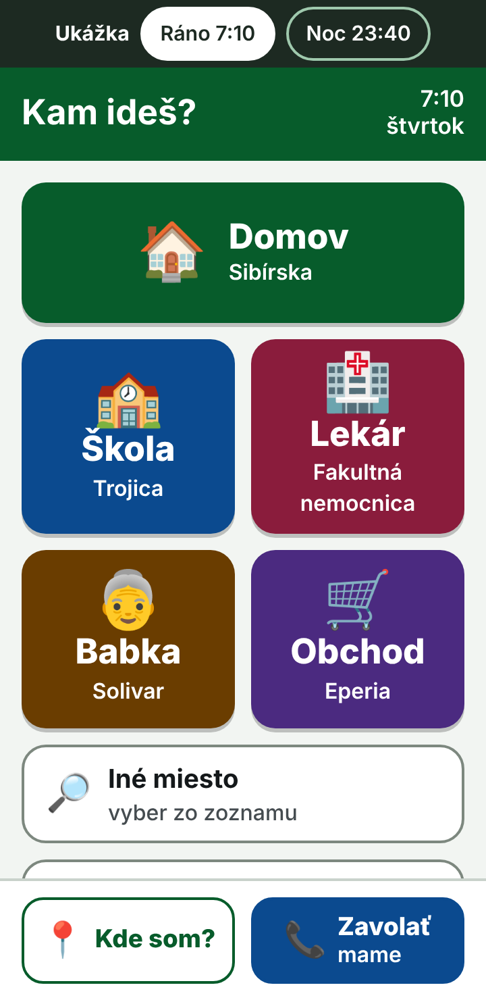 | 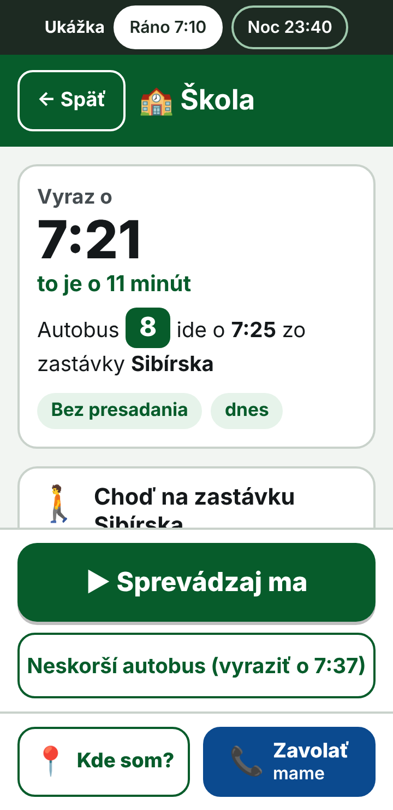 | 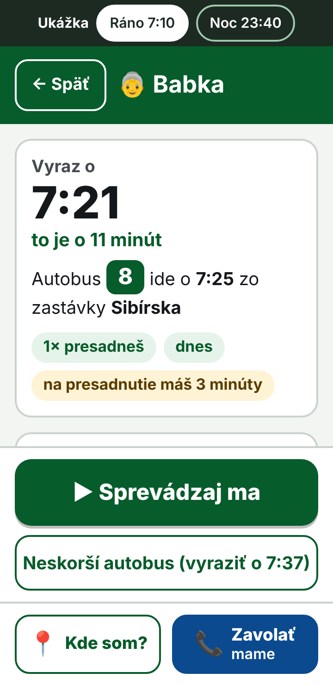 | 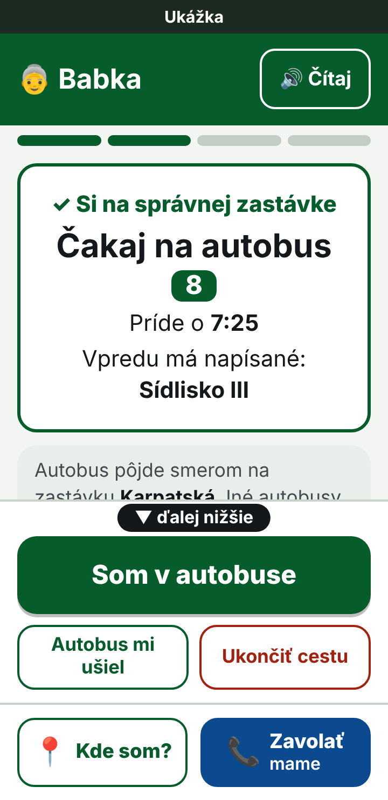 |

| Jazda | Upozornenie | Kde som? | Noc |
|---|---|---|---|
| 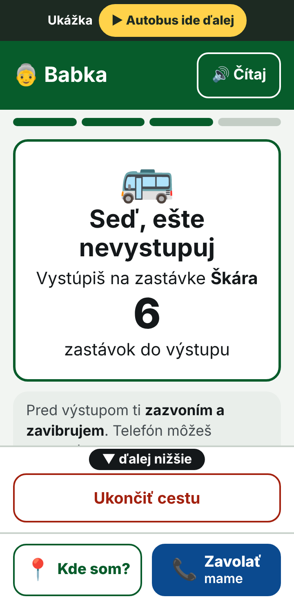 | 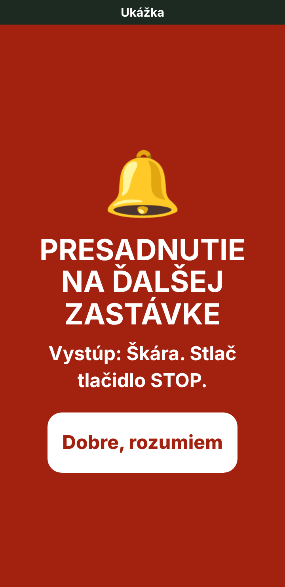 | 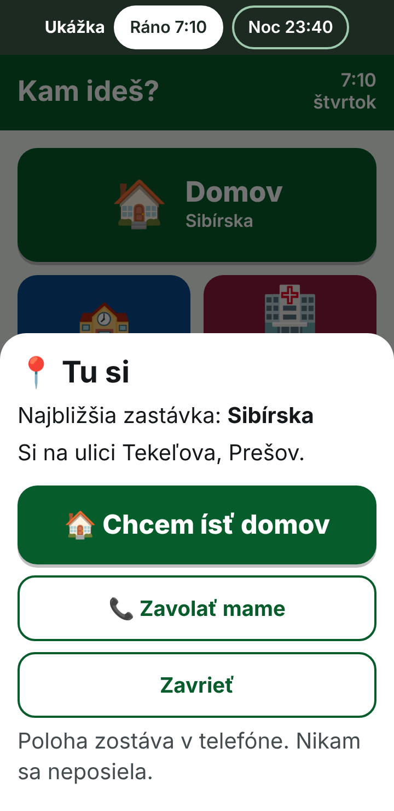 | 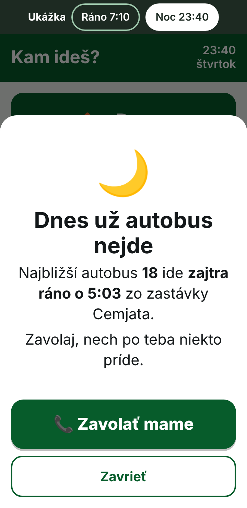 |

Navádzanie pešo na zastávku (kapitola 5.5):

| Úvod | Šípka | Mapka | Pri zastávke |
|---|---|---|---|
| 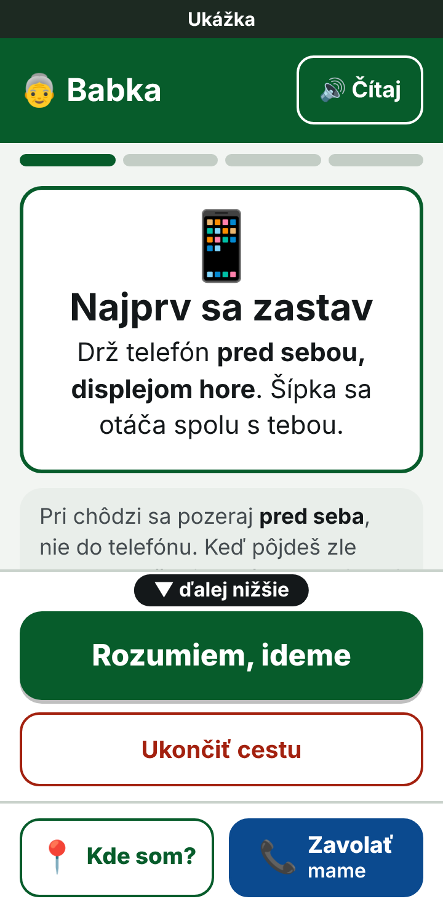 | 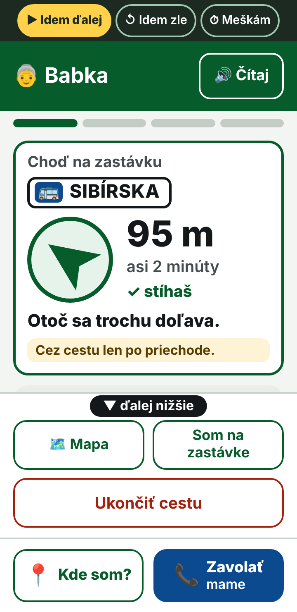 | 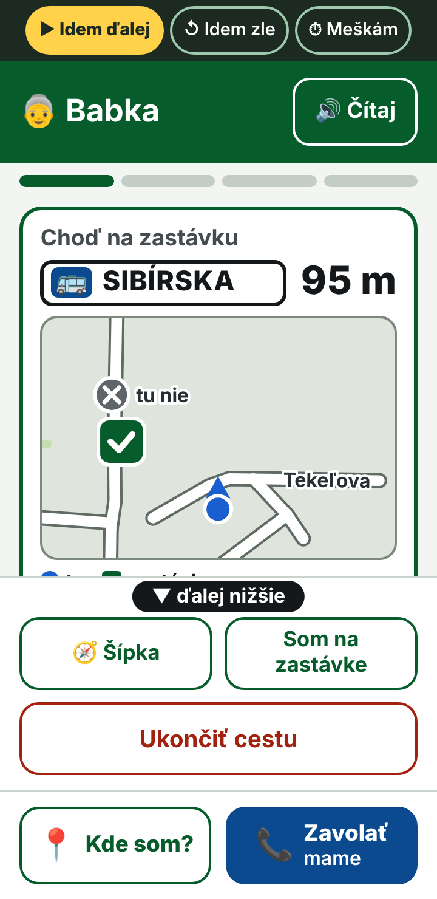 | 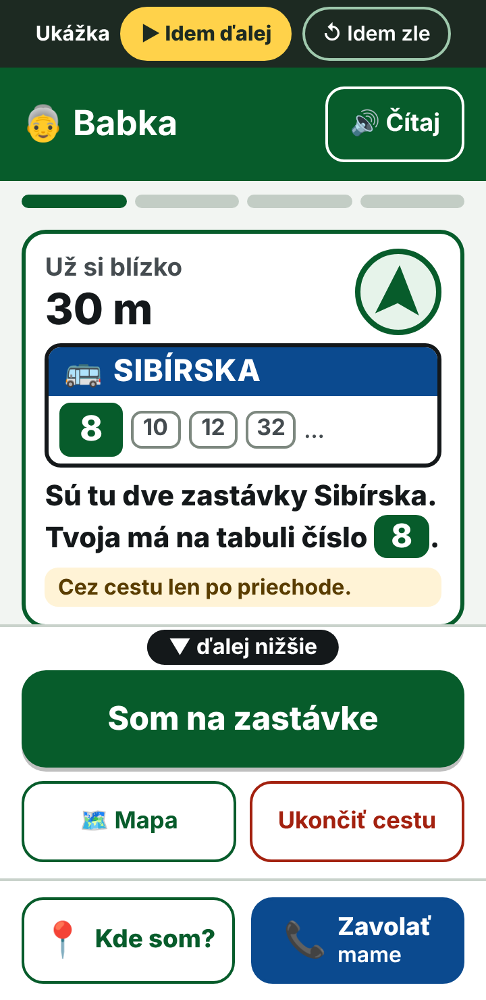 |

| Kontrola čísla | Kontrola smeru | Odpoveď „Nie“ | Odpoveď „Neviem“ |
|---|---|---|---|
| 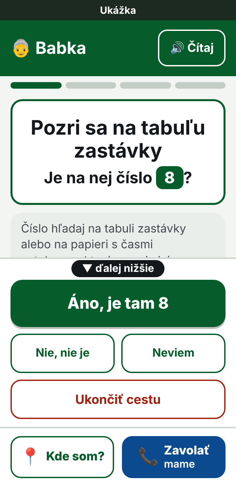 | 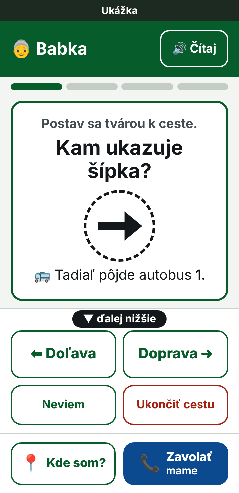 | 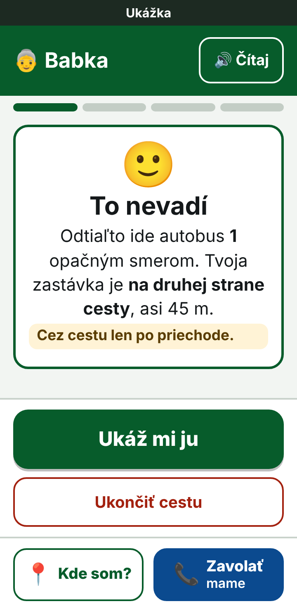 | 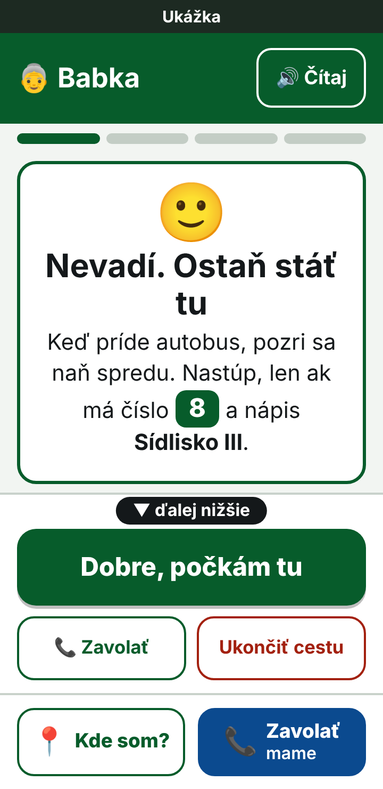 |

| Zlý smer | Ťukol priskoro | Nestíha | Pešo do cieľa |
|---|---|---|---|
| 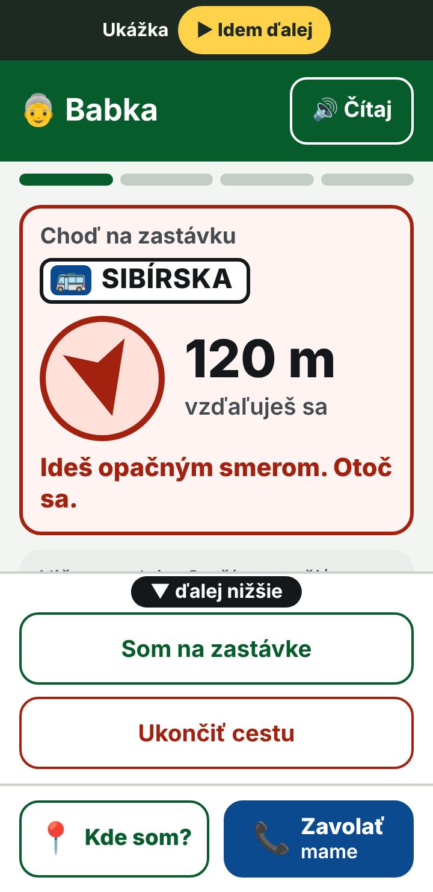 | 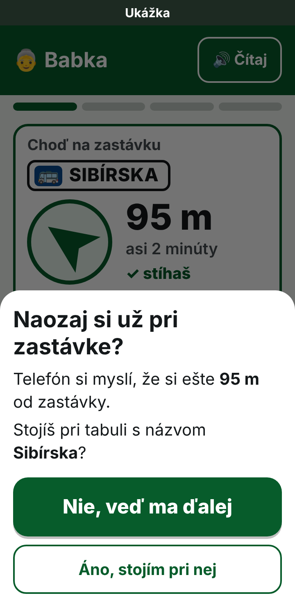 | 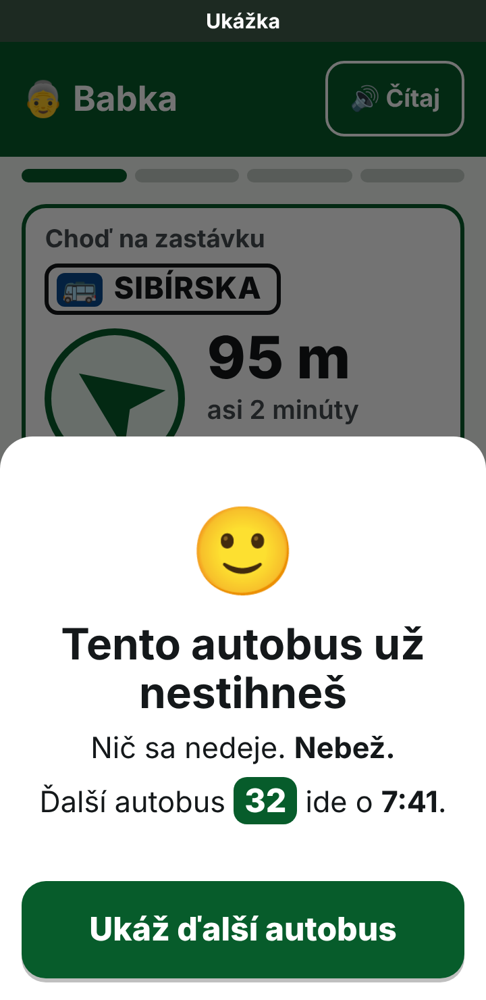 | 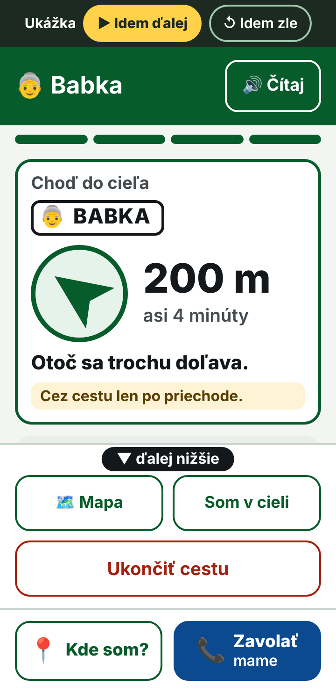 |

### 5.1 Zásady

1. **Žiadne písanie pri bežnom použití.** Úvod tvorí 4–6 veľkých dlaždíc cieľov (obrázok + slovo), ktoré raz nastaví dospelý.
2. **Jedna odpoveď, nie zoznam.** Po ťuknutí na cieľ appka povie „Vyraz o 7:21“ a kroky vo vetách. Iný čas je pod jedným tlačidlom „Neskorší autobus“.
3. **Sprevádzanie pre každú cestu.** Jeden pokyn na obrazovku, hlavné tlačidlo vždy dole („Som na zastávke“, „Nastúpil som“, „Vystúpil som“), počet zastávok do výstupu veľkou číslicou. Dnešné upozornenie na výstup ostáva.
4. **Pomoc vždy na očiach.** Spodná lišta „Kde som?“ a „Zavolať …“ je na každej obrazovke.
5. **Veľké a čitateľné.** Text najmenej 16 px, bežne 18–20 px, čas odchodu vyše 50 px; každé tlačidlo aspoň 56 px vysoké s medzerou 10–12 px; všetok text má kontrast aspoň 7 : 1 a okraje 3,7 : 1. V ukážke to platí na displejoch 320, 360 aj 412 px.
6. **Celé vety a bežné slová.** „Na tabuli má napísané: Sídlisko III“ namiesto „smer“, „Bez presadania“ namiesto „bez prestupu“, „stlač STOP“ pri zastávke na znamenie, „dnes“ a „zajtra ráno“.

### 5.2 Pravidlá plánovania v režime

| Pravidlo | Návrh | Prečo |
|---|---|---|
| Presadanie | len keď inak nejde; na presadnutie aspoň 3 minúty | 7,5 % dnešných odporúčaní má prestup s 0–1 min |
| Tempo chôdze | pomalšie (asi 3,2 km/h) a 1 minúta navyše na príchod na zastávku | pri bežnom tempe zmešká pomalší chodec 5–12 % prvých spojov |
| Čas odchodu | vždy „Vyraz o …“ vrátane chôdze na zastávku | dnes na karte chýba |
| Chôdza namiesto autobusu | len na krátku vzdialenosť (napr. do 400–500 m) | dnes pošle aj 1–2,5 km pešo |
| Zastávky | radšej autobus bližšie k cieľu a menej chôdze | |
| Večer a noc | „Dnes už autobus nejde, najbližší ide zajtra ráno o …“ a ponuka zavolať | dnes „Čakaj… o 5 h 23 min“ |
| Vždy „teraz“ | žiadny dátum a čas na obrazovke | zastaraný čas dnes vráti spoj, ktorý už odišiel |

Konkrétne hodnoty (3 minúty, tempo, 400–500 m) sú návrh. Treba ich potvrdiť skúškou s niekoľkými deťmi a seniormi.

### 5.3 Ochrany

- Ciele, telefónne číslo a pravidlá nastavuje dospelý v chránených nastaveniach (v ukážke otázka „7 × 8“).
- V režime nie je ponuka Plus ani platená SMS.
- Pred ukončením cesty sa appka spýta; systémové Späť cestu neukončí.
- Žiadne otváranie iných aplikácií jedným ťuknutím (Google Maps).
- Pruh „Cestovný poriadok je starý – aktualizuj aplikáciu“ pri štarte.
- Poloha ostáva v telefóne ako doteraz.

### 5.4 Čo treba rozhodnúť

1. **Koľko cieľov bude v jednoduchom režime zadarmo.** Dnes sú zadarmo 2, ďalšie sú v Plus. Režim dáva zmysel so 4–6 cieľmi. Odporúčam v jednoduchom režime povoliť aspoň 4 zadarmo.
2. **Pre koho sa režim oficiálne ponúkne.** V Google Play je appka deklarovaná pre vek 13 a viac („nie pod 13“) a práve je na kontrole pred prvým zverejnením. Režim výslovne pre mladšie deti by znamenal zmenu deklarácie. Odporúčam názov „Jednoduchý režim“ a komunikovať ho pre seniorov a začiatočníkov; presné pravidlá Google som neoveroval.
3. **Tlačidlo „Zavolať“.** Stačí otvoriť telefón s uloženým číslom, nové povolenie netreba. Poslanie polohy SMS-kou navrhujem nechať na neskôr.
4. **Minimálna rezerva na prestup aj v bežnom režime.** 2 minúty by znamenali neskorší príchod v 7 % hľadaní (medián o 5 min). Odporúčam aspoň tesný prestup na karte označiť.

### 5.5 Navádzanie pešo na zastávku (doplnené 11. 11. 2026)

Dieťa ani senior často nevie, ako sa zastávka volá, ani kde je. Pokyn „Choď na zastávku Sibírska“ im preto nestačí. Jednoduchý režim má človeka na zastávku **doviesť** a pomôcť mu **spoznať správne nástupište**. V ukážke je to prvý krok po ťuknutí na „Sprevádzaj ma“; chôdza sa v nej krokuje žltým tlačidlom „Idem ďalej“ v hornej lište.

**Čo je na obrazovke**

1. **Úvod pri prvých cestách.** „Najprv sa zastav. Drž telefón pred sebou, displejom hore. Šípka sa otáča spolu s tebou.“ A hneď aj pravidlo: pri chôdzi sa pozerať pred seba, nie do telefónu.
2. **Veľká šípka a vzdialenosť.** Šípka v kruhu (104 px, na nízkom displeji 96 px) ukazuje priamo na nástupište. Vedľa nej sú metre, minúty a „✓ stíhaš“. Pod ňou jedna krátka veta („Choď rovno.“, „Otoč sa trochu doľava.“, „Otoč sa. Zastávka je za tebou.“) a stála pripomienka **„Cez cestu len po priechode.“**
3. **Zlý smer.** Keď sa vzdialenosť zväčšuje, karta sčervenie, telefón zavibruje a povie „Ideš opačným smerom. Otoč sa.“ Porovnáva sa len vzdialenosť, takže to funguje aj bez kompasu a s telefónom vo vrecku.
4. **Mapka na jedno ťuknutie.** Otáča sa s človekom: čo má pred sebou, je hore. Sú na nej ulice (s názvom, kde sa zmestí), modrá bodka (ty), zelený štvorec s fajkou (tvoja zastávka), sivý krúžok s krížikom a nápisom „tu nie“ (iné nástupište s rovnakým menom) a čierna šípka smeru, ktorým autobus odíde. Čiara od človeka k zastávke sa zámerne nekreslí, aby nikoho neviedla cez cestu.
5. **Blízko zastávky (do 40 m) sa obrazovka zmení** na obrázok tabule s názvom zastávky. Číslo autobusu sa na nej zvýrazní len tam, kde ním zastávku naozaj spozná; pri zastávkach oproti sebe majú to isté číslo obe, preto tam appka napíše „Zastávky Na Hlavnej sú tu dve, oproti sebe. Pri zastávke sa ťa opýtam, či stojíš na správnej strane.“ Na takú vzdialenosť je poloha nepresná, preto ďalej vedie zrak, nie šípka.
6. **Jedna kontrolná otázka pri zastávke** (ďalej).
7. **Hlas a vibrácie.** Krátky pokyn sa povie sám pri každej zmene: na začiatku, cestou, blízko zastávky, pri zlom smere a pri otázke. Hlas povie aj to, že medzi človekom a zastávkou je ulica, a pripomenie priechod. Tlačidlo „Čítaj“ pokyn zopakuje. Sám od seba hovorí len telefón, ktorý má slovenský alebo český hlas (tak je to aj v dnešnej appke).
8. **Tá istá obrazovka pri presadaní a na ceste do cieľa:** „Teraz choď na zastávku …“ a „Choď do cieľa“.

**Prečo nestačí doviesť na súradnice**

Merané nad celým cestovným poriadkom (459 nástupíšť s odchodmi, 260 mien zastávok):

- 85,6 % nástupíšť má ďalšie nástupište s rovnakým menom; 43,4 % ho má do 30 m a 61,0 % do 60 m. Poloha telefónu kolíše o 10–20 m, takže stranu cesty spoľahlivo nerozlíši. Dnešný režim cesty pritom považuje človeka za „na zastávke“ už 45 m od nej.
- Zastávka sa väčšinou volá inak ako ulica, na ktorej stojí (zastávka Sibírska je na Vihorlatskej). Názov ulice sa dá uviesť pri 75,4 % nástupíšť.
- Orientačný bod, ktorý spozná aj dieťa (škola, kostol, veľký obchod), je do 60 m asi pri pätine nástupíšť. Vetu „zastávka je pri …“ preto appka použije len tam, kde taký bod naozaj je; v ukážke nie je ani raz.

Čím sa nástupištia s rovnakým menom dajú odlíšiť (1 644 kombinácií nástupište × linka × smer; ďalšie nástupište sa berie do 150 m):

| Prípad | Podiel | Čo appka urobí |
|---|---|---|
| Iné nástupište s rovnakým menom do 150 m nie je | 19,3 % | nič sa nepýta, stačí poloha |
| Iné nástupište túto linku nemá | 21,5 % | „Pozri sa na tabuľu zastávky. Je na nej číslo 8?“ |
| Z iného nástupišťa ide linka opačným smerom (rozdiel smeru viac než 90°; v 45,3 % takmer presne oproti) | 55,4 % | „Postav sa tvárou k ceste. Kam ukazuje šípka?“ |
| Linka ide z oboch nástupíšť podobným smerom (19 zastávok) | 3,8 % | v 57 zo 62 prípadov rozhodne názov nasledujúcej zastávky; vo zvyšných ide linka z oboch na tú istú zastávku, takže je jedno, kde nastúpi |

Otázka sa kladie, keď je iné nástupište bližšie než 60 m (51 % kombinácií) alebo keď človek ťukol „Som na zastávke“ sám. Ak ho priviedla poloha a iné nástupište je ďalej, otázka netreba. V ukážke sú tri najčastejšie situácie: Sibírska (číslo linky, 38 m), Na Hlavnej (smer, 46 m) a Škára (smer, 106 m).

**Otázka pri zastávkach oproti sebe.** Šípka na obrazovke ukazuje smer, ktorým autobus odíde, a otáča sa s telefónom. Jazdí sa vpravo, takže kto stojí pri správnej zastávke tvárou k ceste, tomu autobus odchádza **doprava**; na opačnej strane by šípka ukazovala doľava. Otázka má preto len dve veľké odpovede, „Doľava“ a „Doprava“, a netreba pri nej sledovať premávku. V dátach to sedí: nástupište leží vpravo od osi ulice v smere jazdy v 94 % merateľných prípadov (487 z 518).

**Odpovede na kontrolnú otázku**

- **Áno / Doprava** → „✓ Si na správnej zastávke“ a čakanie. Fajka sa ukáže len po správnej odpovedi alebo keď správne miesto potvrdí poloha; inak je čakanie bez nej.
- **Nie / Doľava** → krátke vysvetlenie („Odtiaľto ide autobus 1 opačným smerom. Tvoja zastávka je na druhej strane cesty, asi 45 m.“), navedenie šípkou s výstrahou „Zastávka je za cestou. Prejdi len po priechode.“ a po príchode tá istá otázka znova. Druhé „Nie“ už nikam neposiela.
- **Neviem** → nikam ho neposiela. Pri zastávkach oproti sebe: „Ostaň stáť tu. Keď príde autobus, pozri sa naň spredu. Nastúp, len ak má číslo 1 a nápis Solivar.“ Pri otázke na číslo: „Na tabuli alebo na papieri s časmi autobusov má byť číslo 8. Ak tam nie je, tvoja zastávka je asi 40 m odtiaľto.“ s tlačidlami „Počkám tu“, „Ukáž mi druhú zastávku“ a „Zavolať“.
- **„Som na zastávke“ ťuknuté priskoro** (poloha ukazuje viac než 40 m) → „Telefón si myslí, že si ešte 95 m od zastávky. Stojíš pri tabuli s názvom Sibírska?“ Prvá voľba je „Nie, veď ma ďalej“.

**Čas a ďalšie stavy**

- Stav sa má počítať z odchodu autobusu a zostávajúcej chôdze: „✓ stíhaš“; pri tesnej rezerve „Autobus príde o chvíľu. Nebež.“; keď to už nevyjde, „Tento autobus už nestihneš. Nič sa nedeje. Nebež. Ďalší autobus ide o 7:41.“ a plán sa prepne na ďalší spoj. Pokyn „bež“ appka nedá nikdy. V ukážke je „stíhaš“ napevno a „nestihneš“ sa vyvolá tlačidlom „Meškám“.
- Zastávka na znamenie pri nástupe: „Keď prichádza autobus 46, zdvihni ruku.“ Presné znenie treba zosúladiť s prepravným poriadkom DPMP.
- Obrazovka čakania ukazuje číslo autobusu a nápis, ktorý má vpredu.
- Stavy, ktoré ukážka nemá a appka ich potrebuje: poloha ešte nie je známa („Ešte hľadám, kde si. Postoj chvíľu vonku.“); telefón bez kompasu („Urob pár krokov rovno“ a potom len „blížiš sa / vzďaľuješ sa“); telefón držaný pri tele alebo naležato („Podrž telefón pred sebou“); človek už stojí na zastávke, keď cestu spustí (rovno kontrolná otázka).
- Navrhujem aj poistku po nástupe. Dnes appka v prípade, že človek nastúpi do iného autobusu, najskôr minútu po odchode napíše „Spoj ti pravdepodobne ušiel“ a naplánuje cestu z miesta, kde práve je – teda z idúceho autobusu. Nepovie mu, že sedí v inom autobuse. Má povedať: „Si v inom autobuse. Vystúp na ďalšej zastávke.“

**Ako sa to zapojí do appky**

Navádzanie je prvý krok dnešného režimu cesty, len inak nakreslený. Väčšina potrebného v appke už je:

| Čo treba | Stav vo v1.7.3 |
|---|---|
| Poloha, kompas, vibrácie, hlas | je |
| Sledovanie cesty pri zhasnutom displeji | len v Android appke |
| Kroky cesty „na zastávku → čakaj → jazda → do cieľa“ | je (režim cesty) |
| Šípka na zastávku so vzdialenosťou | je, ale malá (kruh 38 px, text 13–15 px); bez kompasu ukazuje „voči severu“ |
| Mapa bez internetu s ulicami a názvami | je, ale so severom hore; otáčať sa nevie |
| Súradnice každého nástupišťa a linky na ňom | je v dátach |
| Smer odchodu autobusu z nástupišťa | je, ale ako vzdušný smer k ďalšej zastávke; pri Sibírskej sa od ulice líši o 48° |
| Automatické „si na zastávke“, „nastúpil si“, „spoj ti ušiel“ | je |

Dorobiť treba:

1. veľkú obrazovku so šípkou, vetami, stavom času a úvodom,
2. rozpoznanie zlého smeru zo zmeny vzdialenosti,
3. obrázok tabule, výber kontrolnej otázky podľa tabuľky vyššie a jej odpovede,
4. overenie ručného „Som na zastávke“ a fajku len po overení,
5. pri zostavovaní dát: názov ulice pri nástupišti, smer odchodu zrovnaný s ulicou, čím sa nástupište líši od ostatných a ktoré ulice a potoky sú v ceste (v ukážke to už počíta skript v podkladoch),
6. otáčanú mapku (vlastné kreslenie z uložených ulíc) – najprácnejšia časť,
7. náhradu pre telefón bez kompasu a poistku „si v inom autobuse“,
8. texty v dvoch podobách: tykanie pre deti, vykanie pre dospelých a seniorov, bez rodových koncoviek („Som v autobuse“ namiesto „Nastúpil som“). Voľba je v chránených nastaveniach; ukážka zatiaľ tyká.

Odkaz do Google Maps sa v jednoduchom režime nepoužije (zásada z 5.3: žiadny odchod z appky jedným ťuknutím).

**Obmedzenia**

- **Šípka vedie vzdušnou čiarou.** Sieť chodníkov a priechodov appka nemá (v dátach je pre celé mesto 119 úsekov peších ciest – chodníky, cestičky, schody, cyklotrasy – bez priechodov a bez nadväznosti). Nepovie „prejdi cez priechod tu“ a neobíde dom ani plot. Vie len upozorniť, že medzi človekom a zastávkou je ulica alebo potok („Medzi tebou a zastávkou je ulica Tekeľova“), a stále pripomínať priechod.
- **Otázka „Kam ukazuje šípka?“ potrebuje kompas** a predpokladá bežnú ulicu, kde autobus stojí pri pravom okraji. V zálive, na konečnej s viacerými stanovišťami alebo pri rozladenom kompase pomôže len odpoveď „Neviem“ a nápis na autobuse. Treba ju vyskúšať v teréne.
- **Kompas telefónu býva nepresný** pri autách a kove a niektoré lacnejšie telefóny ho nemajú. Preto poistka zo vzdialenosti a náhrada bez kompasu.
- **Prahy 40 m (zmena obrazovky), 15 m (príchod) a 60 m (kedy sa pýtať) sú odhad** a treba ich doladiť v teréne.
- **Neoveril som, čo je na označníkoch DPMP.** Otázka „Je na tabuli číslo 8?“ predpokladá, že na označníku alebo na vyvesenom cestovnom poriadku sú čísla liniek.
- **Veľké uzly** (Železničná stanica, Trojica, Veľká pošta) majú v dátach menej nástupíšť než v skutočnosti.
- **Bez ľudí.** Ani táto časť nebola skúšaná s deťmi a seniormi.

**Ako bol návrh preverený.** Obrazovky prešli dvoma kolami nezávislého posudku: z pohľadu dieťaťa, seniora a technického overovateľa, ktorý prepočítal čísla vlastnými skriptmi a porovnal tvrdenia s kódom appky. Prvé kolo našlo štyri vážne veci: fajku „si na správnej zastávke“ bez overenia, odpoveď „neviem“, ktorá človeka poslala cez cestu, čiaru na mapke vedúcu cez vozovku a chýbajúci pokyn pozerať pred seba. Druhé kolo potvrdilo, že žiadny z 18 nálezov neostal neopravený (13 úplne, 5 čiastočne), a našlo ďalšie: zvýraznené číslo linky pri zastávkach oproti sebe, upozornenie na priechod chýbajúce v hlase a pri oprave, šípku autobusu mieriacu na človeka. Aj tie sú zapracované. Posledná úprava – otázka „Kam ukazuje šípka?“ namiesto porovnávania s premávkou – vznikla až po druhom kole; prešla automatickým testom ukážky (220 obrazoviek na štyroch veľkostiach displeja) a kontrolou na dátach, posudzovatelia ju už nevideli.

**Druhá etapa:** doplniť do dát chodníky a priechody z OpenStreetMap. Mapka by potom ukázala skutočnú cestu a appka by vedela povedať „prejdi cez priechod“. Je to väčšia práca a zväčší appku; veľkosť treba najprv zmerať.

**Čo treba rozhodnúť alebo overiť**

1. Čo je na označníkoch zastávok v Prešove (čísla liniek?) – podľa toho znenie kontrolnej otázky.
2. Či má byť mapka už v prvej verzii, alebo stačí šípka a obrázok tabule.
3. Tykanie a vykanie: či stačí voľba v nastaveniach, alebo sa má režim pýtať pri prvom spustení.
4. Skúška v teréne aspoň na troch zastávkach z ukážky (Sibírska, Na Hlavnej, Škára), najmä otázka „Kam ukazuje šípka?“.

## 6. Odporúčané poradie prác

**Rozhodnutie z 11. 11. 2026: rieši sa teraz len balík C (jednoduchý režim).** Balíky A a B počkajú.

**A. Opravy bez zmeny vzhľadu (malé, dajú sa vydať ako 1.7.4)**

1. Oprava chyby 1 a 2 v plánovači (skúšobná oprava je hotová) a doplnenie testov.
2. Štítok „zajtra“ na karte a veta „Dnes už nič nejde“.
3. „Vyraz o …“ a chôdza na prvú zastávku v karte.
4. Prijať presne napísaný názov; návrhy nesmú prekrývať pole „Kam“; hláška pri prázdnom výsledku.
5. Skloňovanie, čitateľný tmavý vzhľad, otázka pred ukončením cesty, zapnúť priblíženie v Android appke.

**B. Lepšie plánovanie**

1. Strop 8 nástupíšť nahradiť počítaním podľa zastávok alebo ho zrušiť (výpočet sa nespomalí).
2. Keď najbližší spoj ide o veľa neskôr alebo vôbec, skúsiť zastávky do 1–1,5 km a ukázať samostatnú kartu „skôr, ale viac pešo“.
3. Okolité zastávky aj pri štarte zo zastávky; pri cieli dovoliť dôjsť z výstupnej zastávky pešo.
4. Označenie tesného prestupu a voliteľná minimálna rezerva; nastavenie tempa chôdze.
5. Tlačidlá „Neskôr“ a „Skôr“; neskorý priamy spoj nepočítať do štyroch kariet.
6. Opravy chýb 3–6.
7. Overiť u DPMP 136 možných väzieb „zostaň sedieť“.

**C. Jednoduchý režim**

1. Tlačidlo „Sprevádzaj ma“ na každej karte spojenia (predpoklad pre celý režim, užitočné aj v bežnom).
2. Úvodná obrazovka režimu, odpoveď vo vetách, pravidlá plánovania z 5.2.
3. Navádzanie pešo na zastávku z 5.5: najprv šípka, zlý smer, tabuľa a kontrolná otázka; mapka a náhrada bez kompasu ako druhý krok.
4. „Kde som?“ a „Zavolať“.
5. Chránené nastavenia a ochrany z 5.3.
6. Skúška s 3–5 seniormi a 3–5 deťmi pred vydaním, vrátane cesty na zastávku v teréne.

## 7. Obmedzenia analýzy

- **Rovnaké dáta.** Appka aj nezávislý výpočet čítajú ten istý súbor cestovných poriadkov. Chyby v prevode z dát DPMP táto analýza neodhalí.
- **Štyri dni.** Merané boli 12. 11., 14. 11., 15. 11. a 29. 10. 2026.
- **Náhodné dvojice nie sú skutočný dopyt.** Okrajové zastávky sú v nich zastúpené viac než v reálnom používaní, preto uvádzam osobitne 25 najvyťaženejších zastávok.
- **Prehliadač, nie telefón.** Obrazovka sa merala v Chromiu. Funkcie dostupné len v Android appke (Plus, tmavý vzhľad, ukončenie) boli simulované. Zväčšenie písma je emulácia.
- **Bez používateľov.** Hodnotenie pre deti a seniorov je odborný posudok, nie test s ľuďmi.
- **Odhad chôdze sa nedal overiť** (v repozitári nie je sieť chodníkov).
- **Neprepočítané druhým overovateľom:** podiel textu pod 16 px v celej appke (80 %), presnosť ťuknutia na zastávku na mape, správanie pri otvorenej klávesnici a simulácia vyššej rezervy na prestup v zozname kariet.

## 8. Podklady

- `jednoduchy-rezim-ukazka.html` – klikateľná ukážka jednoduchého režimu (jeden súbor, bez internetu).
- `obrazky/` – snímky ukážky a súčasnej appky.
- `podklady/harness.mjs` – spustí skutočné plánovanie appky mimo prehliadača.
- `podklady/oracle.mjs` – nezávislý výpočet najlepšieho spojenia.
- `podklady/raptor-oprava-stitkov.diff` – skúšobná oprava chýb 1 a 2 (nie je nasadená).
- `podklady/nastupistia-rozlisenie.mjs` – čísla z kapitoly 5.5: nástupištia s rovnakým menom, čím sa dajú odlíšiť, názvy ulíc a orientačné body.
- `podklady/navadzanie-data.mjs` – príprava skutočných dát pre obrazovky navádzania v ukážke (vzdialenosti, smery, mapky).
